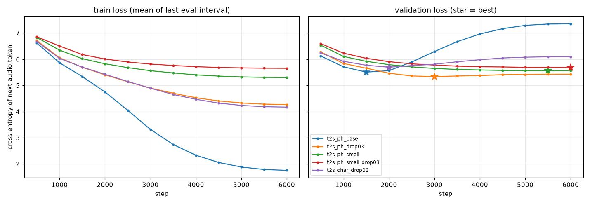
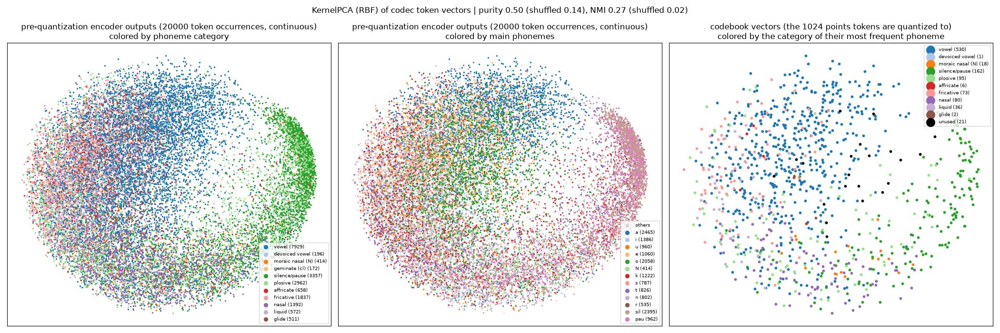
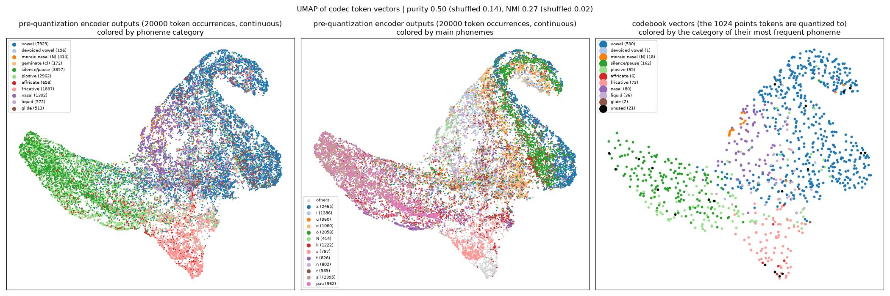
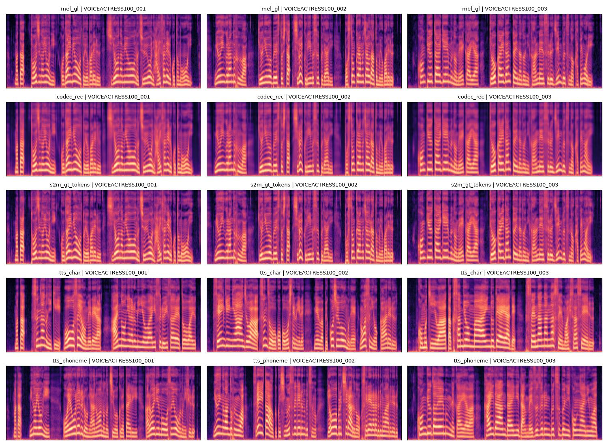

# exp0001: IndexTTS の構成を簡略化したスクラッチ実装(1 話者・テキストのみの読み上げ)

## 目的

IndexTTS2.5 の大枠の構成(T2S → S2M → ボコーダの 3 段)と処理の流れを、外部の学習済みモデルを使わずに
簡略化して実装し、日本語 1 話者(JSUT)の「テキストだけを入力して読み上げる」TTS を作る。
公式レベルの作り込み(学習済み特徴抽出器・話者参照・感情制御など)は、後の実験で行う。

## 全体の構成

```
テキスト ── 前処理(文字 or 音素+アクセント)── ID 列
   │
   ▼
① T2S(GPT): テキストを読み、音声トークンを 1 個ずつ予測する(<EA> が出たら終わり)
   │  音声トークン列(約 23.4 個/秒、各 0〜1023)
   ▼
② S2M: トークン → codec decoder の特徴 → Mel の長さに引き伸ばす → Flow Matching で Mel を生成
   │  Mel(93.75 フレーム/秒 × 80 帯域)
   ▼
③ ボコーダ: Griffin-Lim で Mel から波形(24kHz)に戻す
```

学習は次の順に、部品ごとに行う。

1. **codec**(`train_codec.py`): Mel ⇔ 音声トークンの変換を学習する。以降は固定する
2. **T2S**(`train_t2s.py`): テキスト → 音声トークン列。正解は、正解音声を codec でトークンにしたもの
3. **S2M**(`train_s2m.py`): 音声トークン列 → Mel。T2S とは独立に学習できる

### IndexTTS2.5 との対応と、簡略化した点

| 部品 | IndexTTS2.5 | exp0001 |
|---|---|---|
| テキスト入力 | 日本語は文字のまま(G2P なし) | **文字のまま** と **pyopenjtalk の音素 + アクセント記号** の両方を作って比べる |
| 音声トークン | 学習済み w2v-BERT 2.0 の特徴を codec で量子化(25Hz、8192 種) | **Mel を codec で量子化**(23.4Hz、1024 種)。外部モデルは使わない |
| codec の構成 | ConvNeXt + 8 次元の L2 正規化 VQ。損失は再構成 + 0.15×commit + codebook | 同じ形。復元先が w2v-BERT 特徴ではなく Mel |
| T2S | GPT-2(ランダム初期化)。テキスト・音声で別々の位置埋め込み。音声トークンの CE のみ | 同じ。**話者・感情の条件はなし**(1 話者のため) |
| T2S の生成 | temperature 0.8、top_p 0.8、top_k 30、繰り返しペナルティ 10、**ビームサーチ 3** | ビームサーチ以外は同じ値。**ビームサーチはなし** |
| S2M | codec decoder の特徴 → length regulator → DiT(adaLN・RoPE・U 字 skip など)で Flow Matching。参照 Mel・話者ベクトルを条件に入れる | codec decoder の特徴 → length regulator → DiT(adaLN-Zero・RoPE の素直な積み重ね)。**参照 Mel・話者ベクトルはなし** |
| S2M の生成 | Euler 25 step、CFG 0.7 | 同じ |
| ボコーダ | 学習済み BigVGAN | **Griffin-Lim**(学習不要。音質は悪い)。NN ボコーダのスクラッチ学習は後の実験で行う |
| Mel | 22.05kHz、80 帯域 | 24kHz、80 帯域、hop 256 |

## データ

- **JSUT ver1.1**(女性 1 人、7,696 発話、10.27 時間)。リポジトリ直下の `datasets/` に置く
- 分割: test = `voiceactress100`(100 文。JVS の `parallel100` と同じ文で、後の多話者実験と比べられる)、
  val = 残りからランダムに 100 文、train = 残りの 7,496 文
- 起動時に全 wav を 24kHz の log-Mel にしてメモリに置く(前処理ファイルは作らない。1 ファイル約 5ms)
- テキストの語彙: 文字は 2,745 種、音素 + アクセント記号は 50 種。テスト文には、学習データに無い文字・音素は無い

テキストの前処理の例(`phoneme`):

```
東京都に住んでいる。 → ^ t o [ o ky o o ] t o n i # s u ] N d e # i [ r u $
  ^ 文頭  $ 文末  ? 疑問文の文末  _ ポーズ  # アクセント句の区切り  [ 声が上がる  ] 声が下がる(アクセント核)
```

## 評価の方法

テスト 100 文を合成し、学習済みの日本語 ASR(NVIDIA `parakeet-tdt_ctc-0.6b-ja`)で書き起こして、
文字誤り率(CER)を測る。主な指標は、漢字・かなの表記の違いを除くために読み(カタカナ)にそろえた CER。

TTS 全体の誤りがどの部品で増えたかを切り分けるため、途中の段階から作った音声も同じ方法で測る。

| 条件 | 経路 | 分かること |
|---|---|---|
| `real` | 元の録音 | ASR 自体の誤り(下限) |
| `mel_gl` | 正解 Mel → Griffin-Lim | Griffin-Lim による劣化 |
| `codec_rec` | 正解トークン → codec decoder → Griffin-Lim | codec(量子化)による劣化 |
| `s2m_gt_tokens` | 正解トークン → S2M → Griffin-Lim | S2M による劣化 |
| `tts_char` | 文字 → T2S → S2M → Griffin-Lim | TTS 全体(文字入力) |
| `tts_phoneme` | 音素 + アクセント → T2S → S2M → Griffin-Lim | TTS 全体(音素入力) |

T2S が決めた音声の長さと、正解の長さの比も記録する(<EA> を出せずに上限まで生成した数も)。

## 実行方法

必要なパッケージ: torch、transformers、librosa、soundfile、pyopenjtalk、matplotlib、pandas、
評価に nemo_toolkit[asr]、jiwer、janome。

```bash
python train_codec.py                 # 1. codec
python train_t2s.py --text char       # 2. T2S(文字入力)
python train_t2s.py --text phoneme    #    T2S(音素入力)
python train_s2m.py                   # 3. S2M(T2S と並行して学習してよい)
python evaluate.py                    # 4. テスト 100 文の合成と評価
python synthesize.py --text "今日はいい天気ですね。"   # 好きな文章を読み上げて wav に保存
```

推論は `common/pipeline.py` の `TTSPipeline` にまとめてある(テキスト → T2S → S2M → Griffin-Lim)。
`evaluate.py` と `synthesize.py` はどちらもこれを使う。Python からは次のように使える。

```python
pipe = TTSPipeline.from_checkpoints(codec_path, s2m_path, t2s_path, device="cuda")
out = pipe(["今日はいい天気ですね。"])   # out[0] = {"codes": トークン列, "mel": log-Mel, "wave": 24kHz の波形}
```

各スクリプトに `--limit 40 --steps 6 --device cpu` などを付けると、少数の発話・数 step で動作確認できる。

| 出力 | 中身 | git |
|---|---|---|
| `runs/{codec,t2s_char,t2s_phoneme,s2m}/` | checkpoint と学習ログ | 対象外 |
| `runs/eval/{条件}/` | テスト全 100 文の音声 | 対象外 |
| `results/metrics.json`、`results/per_utterance.csv` | 条件ごとの CER、発話ごとの書き起こし | 対象 |
| `results/samples/{条件}/` | 試聴用に先頭 5 文の音声 | 対象 |
| `results/fig_mels.jpg` | Mel の比較図 | 対象 |

## コードの構成

```
tts/
├── lib_common/           実験に依存しない共通処理
│   ├── audio.py          音声の読み込み、log-Mel、Mel の正規化
│   ├── text.py           テキストの前処理(文字 / 音素 + アクセント)と語彙
│   ├── data.py           JSUT の読み込みと分割
│   ├── vocoder.py        Griffin-Lim(GPU)
│   ├── asr_eval.py       parakeet での書き起こしと CER
│   └── utils.py          乱数の固定、ログ、学習率スケジュール、長さでまとめるバッチ
└── indextts_bases/exp0001/
    ├── common/           exp0001 固有のモデル
    │   ├── codec.py      Mel ⇔ 音声トークン
    │   ├── t2s.py        GPT(テキスト → 音声トークン)
    │   ├── s2m.py        Flow Matching(音声トークン → Mel)
    │   ├── pipeline.py   推論の組み立て(テキスト → 波形。途中の段階も個別に呼べる)
    │   └── utils.py      codec の読み込み・トークン化など
    ├── train_codec.py / train_t2s.py / train_s2m.py / evaluate.py / synthesize.py
    ├── plot_t2s_curves.py        分析: T2S の学習条件ごとの loss の推移の図
    ├── analyze_t2s_near_miss.py  分析: T2S の予測が外れたとき、正解に近いトークンを選べているか
    ├── analyze_t2s_teacher_forced.py  分析: teacher forcing の予測トークンを音にして、T2S の誤りの出どころを切り分ける
    ├── analyze_codec_phoneme.py  分析: codec のトークンが音素ごとにまとまっているか(KernelPCA / UMAP)
    ├── analyze_utmos.py          分析: 評価で作った音声の自然さを UTMOS で比べる(付録)
    └── README.md         このレポート
```

## 結果

### 1. codec の学習

30,000 step(約 15 分)。検証データの復元誤差(正規化した Mel の二乗誤差)と、検証データで使われたトークンの種類数。

| step | 学習データの復元誤差 | 検証データの復元誤差 | 使われたトークン(1024 種類中) | perplexity |
|---|---|---|---|---|
| 1,000 | 0.239 | 0.139 | 781 | 354 |
| 5,000 | 0.092 | 0.091 | 899 | 647 |
| 15,000 | 0.067 | **0.077** | 975 | 816 |
| 30,000 | 0.057 | 0.081 | 984 | 838 |

- codebook の崩壊(一部のトークンしか使われない)は起きず、最後は 1024 種類中 984 種類が使われた
- 検証データの復元誤差は 15,000 step が一番小さく、その後わずかに悪化した(学習データには合わせ込み続けている)。
  `train_codec.py` は最後の step の codec を保存するので、以降は 30,000 step の codec を使っている

### 2. T2S の過学習と、正則化の条件の比較

最初は 40,000 step 学習するつもりだったが、文字入力・音素入力のどちらも、2,000 step 前後(学習データを約 13 周)から
検証データの loss が悪化し、学習データの丸暗記に入った。そこで音素入力で、過学習を抑える条件を 6,000 step ずつ比べた
(どの条件も学習率のスケジュールは同じ)。

| 条件 | パラメータ数 | 検証 loss が一番小さい点(step) | そのときの検証正解率 | 6,000 step の学習 loss / 検証 loss |
|---|---|---|---|---|
| 基準(512 次元・8 層・dropout 0.1) | 27.1M | 5.51(1,500) | 4.1% | 1.75 / 7.35 |
| **dropout 0.3** | 27.1M | **5.34(3,000)** | **4.9%** | 4.27 / 5.43 |
| 小さいモデル(256 次元・4 層) | 4.1M | 5.56(6,000) | 4.0% | 5.30 / 5.56 |
| 小さいモデル + dropout 0.3 | 4.1M | 5.69(6,000) | 3.6% | 5.65 / 5.69 |
| 文字入力 + dropout 0.3 | 28.5M | 5.69(2,000) | 3.7% | 4.17 / 6.10 |

(文字入力は、dropout 0.1 だと 1,000 step(検証 loss 5.89)で悪化に転じた。dropout 0.3 で 2,000 step まで遅れたが、
それでも音素入力の dropout 0.3 より検証 loss は 0.35 悪い)



(左が学習データの loss、右が検証データの loss。星は検証 loss が一番小さい点。基準(青)は 1,500 step から
検証 loss が急に上がる。dropout 0.3(橙)は 3,000 step で最小になり、その後はゆるやかに上がる。
小さいモデルの 2 本(緑・赤)は、学習 loss も下がりきらずに平らになる)

- **dropout 0.3 が一番良かった。** 過学習が始まるのが遅れ(1,500 → 3,000 step)、検証 loss も一番下まで下がった
- 基準は 1,500 step 以降、学習 loss だけが下がり続け(6,000 step で学習データの正解率 57%)、検証 loss は 7.35 まで悪化した
- 小さいモデルは過学習しにくいが、学習データの loss も下がりきらず(容量不足)、検証 loss は基準より悪い
- どの条件でも、検証データの正解率は 5% 前後で頭打ちになった。正則化で「過学習の速さ」は変わるが、
  テキストから当てられる上限そのものは大きく変わっていない。トークンが Mel の細部まで含んでいて
  (codec の perplexity 838)、テキストからは決まらない部分が大きいためと考えられる(未検証)
- **音素入力の方が、文字入力より学習していない文に当てはまる。** 学習データの loss の下がり方は同じなのに、
  文字入力は検証 loss が早く悪化する。文字入力は語彙が 2,745 種類あり、学習データに数回しか出ない漢字が多いので、
  その発話を丸ごと覚えてしまうと考えられる(未検証)
- 以降の評価には、音素入力は dropout 0.3 の 3,000 step(`t2s_ph_drop03`)、文字入力は dropout 0.3 の 2,000 step
  (`t2s_char_drop03`)の checkpoint を使う

### 3. T2S の予測が外れたとき、正解に近いトークンを選べているか

正解率が 5% 前後と低いが、codebook は 1024 個あり、似た音に複数のトークンが割り当てられているはず。
そこで、検証データ 100 文(11,004 トークン)で正解のトークン列を入力して次を予測させ、予測したトークンと
正解のトークンの代表ベクトル(L2 正規化した 8 次元)の cosine 類似度を測った(`analyze_t2s_near_miss.py`)。

| 条件 | 1 位の正解率 | 上位 5 候補に正解 | 類似度(外れたものだけ) | 外れたもののうち類似度 > 0.7 | > 0.9 |
|---|---|---|---|---|---|
| dropout 0.3 | **4.1%** | **14.6%** | **0.44** | **36.6%** | **11.4%** |
| 基準 | 3.2% | 12.6% | 0.40 | 33.0% | 10.5% |
| 小さいモデル | 3.1% | 11.8% | 0.38 | 31.1% | 10.3% |
| 小さいモデル + dropout 0.3 | 3.0% | 11.0% | 0.35 | 28.8% | 10.0% |
| 文字入力 + dropout 0.3 | 2.9% | 11.3% | 0.37 | 30.4% | 9.8% |
| (参考)ランダムなトークン | 0.1% | - | 0.02 | 5% | 0.7% |
| (参考)正解の 1 つ前のトークン | - | - | 0.30 | - | - |

- 外れた予測でも、ランダムよりはるかに正解に近いトークンを選んでいる(類似度 > 0.9 になる割合はランダムの約 16 倍)。
  正解の 1 つ前のトークン(0.30)よりも、正解に近い
- 「正解率が低くても、復元するとそれなりの音になる」可能性は十分ある
- 検証 loss が良い条件ほど、近いトークンを選べている(dropout 0.3 が一番良い)
- 注意: この近さは codec が近さを測る 8 次元の空間でのもので、耳で聞いた近さと一致するとは限らない。
  実際の音は、評価(合成した音声の CER と試聴)で確かめる

### 4. codec のトークンは音素ごとにまとまっているか

jsut-lab の音素アライメント(Julius の強制アライメントで付けた、音素ごとの開始・終了時刻)を使い、
各トークンの区間(42.7ms)と一番長く重なる音素を、そのトークンの正解の音素にした(`analyze_codec_phoneme.py`)。
1,500 発話(検証データ 100 + 学習データ 1,400)、166,491 トークン。トークンの区間のうち、割り当てた音素が占める割合は平均 87%。

| 指標 | 実際のトークン | 比較: トークンをシャッフル(音素と無関係) |
|---|---|---|
| 純度(各トークンで一番多い音素の割合、出現回数で重み付け) | **0.50** | 0.14 |
| NMI(トークンと音素の正規化相互情報量) | **0.27** | 0.02 |
| NMI(トークンと音素の種類) | **0.19** | 0.01 |

1 つの音素の出現の 90% を覆うのに必要なトークンの種類数: sil 156、a 300、o 283、i 279、k 332、e 226、u 425、n 271、s 154、t 329。





(どちらの図も、左 2 枚は量子化する前の encoder の出力(トークンの出現 2 万個、連続値なので同じトークン ID でも少しずつ違う点)、
右 1 枚は codebook の代表ベクトル 1024 個(量子化した後に実際に使われる点)。上が KernelPCA(RBF)、下が UMAP)

- トークンは音素と明らかに関係している(純度・NMI ともシャッフルの 3〜13 倍)
- ただし、1 つのトークンが 1 つの音素にきれいに対応しているわけではない。各トークンで一番多い音素は約半分で、
  1 つの音素は数百種類のトークンにまたがる
- **UMAP では、音素の「種類」の単位ではっきり領域が分かれる。** 無音・ポーズ(sil・pau)と破裂音が左の大きな塊に
  (破裂音は閉鎖の部分がほぼ無音のためと考えられる)、摩擦音(主に s)が下に伸びる別の塊に、母音が右上の広い範囲に集まる。
  鼻音と撥音(N)は母音の近く。ただし母音の中は、a と o はある程度まとまるが、i・u・e は混ざっている
- codebook の 1024 点も同じ配置で、多数派が母音のトークンが 530 個、無音・ポーズ 162 個、破裂音 95 個、鼻音 80 個、
  摩擦音 73 個(使われなかったもの 21 個)。音の種類ごとに、出現の多さに応じて codebook が割り振られている
- KernelPCA でも同じ並び(右に無音、上に母音、左に摩擦音)は見えるが、UMAP より重なりが大きい
- トークンは音素以外の情報(前後の音素とのつながり、声の高さ、音素の中での位置など)も多く持っていると考えられる
  (何の情報かは未検証)。これは 2. で考えた「T2S の正解のトークンに、テキストから決まらない情報が多い」ことと合う。
  発音寄りのトークンにする exp0003 で、この値がどう変わるかを比べる

### 5. 合成した音声の読みの正確さ(ASR の CER)

T2S は検証 loss が一番良かった checkpoint(音素入力 `t2s_ph_drop03`、文字入力 `t2s_char_drop03`)、
S2M は 40,000 step(検証 loss 0.229)を使い、`evaluate.py` で評価した。生成の設定は既定値(T2S は temperature 0.8・
top_p 0.8・top_k 30・繰り返しペナルティ 10、S2M は Euler 25 step・CFG 0.7)。

#### テスト 100 文(JSUT voiceactress100)

| 条件 | 経路 | raw | normalized | **reading** | 長さの比(生成 / 正解) |
|---|---|---|---|---|---|
| `real` | 元の録音 | 11.0% | 5.5% | **2.9%** | - |
| `mel_gl` | 正解 Mel → Griffin-Lim | 11.1% | 5.7% | **3.1%** | - |
| `codec_rec` | 正解トークン → codec decoder → Griffin-Lim | 15.6% | 10.3% | **6.0%** | - |
| `s2m_gt_tokens` | 正解トークン → S2M → Griffin-Lim | 15.8% | 10.9% | **7.1%** | - |
| `tts_phoneme` | 音素 + アクセント → T2S → S2M → Griffin-Lim | 85.0% | 89.7% | **73.5%** | 1.03 |
| `tts_char` | 文字 → T2S → S2M → Griffin-Lim | 91.0% | 94.9% | **86.7%** | 0.96 |

- **正しいトークンさえあれば、codec・S2M・Griffin-Lim の経路はほぼ正しく読める。** 元の録音 2.9% に対し、
  Griffin-Lim で +0.2pt、codec で +2.9pt、S2M で +1.1pt。`s2m_gt_tokens` は 98% の文で CER が 30% 未満だった
- **誤りのほとんどは T2S で起きている。** 正解トークンからの 7.1% に対し、テキストからは 73.5%(音素)・86.7%(文字)
- 音声の長さはほぼ正しい(正解の長さとの比 0.96〜1.03、上限の 600 トークンまで止まらなかった文は 0)
- 書き起こしを見ると、**冒頭の数語は合っていることが多く、その後は日本語らしい音の並びのまま内容が崩れる**
  (例: 「ニューイングランド風は、牛乳を…」→「ニューイングワンドフンはスレイターウクイシグース…」)。
  自己回帰の生成で、学習していない文では途中から正解の流れを外れていく典型的な失敗と考えられる
- 音素入力は文字入力より 13pt 良い。T2S の検証 loss の差(5.34 と 5.69)と同じ向き



(テスト文の先頭 3 文の Mel。上から 正解 Mel、codec decoder の復元、正解トークン → S2M、文字入力の TTS、音素入力の TTS)

- codec decoder で復元した Mel は倍音の縞がぼやけて滑らか。S2M は同じトークンから、元の Mel に近いくっきりした縞を作れている。
  二乗誤差で学習した復元は平均的なぼやけた Mel になり、Flow Matching は本物らしい細部を作れる、という設計どおりの差
- テキストからの TTS の Mel も、倍音の縞や無音の区間がはっきりした音声らしい Mel になっている。
  「音としては音声らしいが、言っている内容が違う」という書き起こしの結果と合う
- 試聴の感想(テスト文・実用文): 声としては自然に聞こえるが、**日本語ではない何かの言語を話しているように聞こえる**。
  音声らしさ(S2M・codec)はできていて、テキストの内容を音にする部分(T2S)ができていない、という上の分析と合う

#### 実用文 55 文(`datasets/eval_texts/practical.tsv`、reading CER)

| カテゴリ | 音素入力 | 文字入力 |
|---|---|---|
| 全体 | **62.5%** | 89.3% |
| 短い文(はい。など) | 52.9% | 141.2% |
| 疑問・感嘆 | 41.3% | 81.3% |
| 文脈で読みが変わる語 | 34.3% | 87.1% |
| オノマトペ | 39.1% | 82.6% |
| 固有名詞 | 43.9% | 86.5% |
| 会話 | 60.8% | 90.2% |
| 英字 | 63.7% | 89.0% |
| ニュース風 | 64.2% | 90.0% |
| 数字 | 75.0% | 98.0% |
| 長い文 | 83.0% | 87.5% |

- 音素入力では「はい。」「そうですね。」「ありがとう。」「本当にそれでいいんですか?」が完全に正しく読めた。
  短い文ほど読めて、長い文ほど崩れる(長い文 83%)のは、上の「途中から崩れる」と同じ傾向
- 文字入力の短い文が 100% を超えているのは、短い正解に対して余分な音を多く生成したため(挿入も誤りに数える)

#### まとめと次の手

- exp0001 の簡略版は、**codec・S2M・Griffin-Lim の経路は機能するが、T2S が学習していない文に一般化しない**
- 原因の候補: (1) Mel を量子化したトークンにテキストから決まらない情報が多い(4. の分析と合う)、
  (2) GPT 型の T2S がテキストと音声の時間の対応を 10 時間のデータで学ぶのが難しい、(3) データ量そのもの
- S2M を予測トークンで学習する案(ロードマップ参照)は、S2M 側の改善なので、今回の 7.1% → 73.5% の差の大部分
  (T2S の誤り)には直接は効かない。先に T2S 側(発音寄りのトークン = exp0003、データ・学習の工夫)を優先する

試聴用の音声: `results/samples/test/{条件}/`(テスト文の先頭 5 文)、`results/samples/eval_texts/{条件}/`(実用文の各カテゴリの先頭 1 文)。
一覧は `results/samples/index.json`。

### 6. T2S の誤りは「1 トークンずつの予測」と「流れを外れること」のどちらから来るか

推論(自由な生成)では、T2S は自分が出したトークンを入力にして次を予測するので、一度ずれると正解の流れに
戻れずにずれ続けることがある。これを切り分けるため、正解のトークン列を入力にして(teacher forcing)各位置で
次のトークンを予測させ、その予測トークン列(正解と同じ長さで位置もそろう)を S2M で音にして CER を測った
(`analyze_t2s_teacher_forced.py --runs t2s_ph_drop03 t2s_char_drop03`、結果は `results/t2s_compare.json`)。
このトークン列は「毎回の予測の誤り」だけを含み、「流れを外れる」誤りは含まない。

| 条件(テスト 100 文) | T2S の入力 | トークンの正解率 | reading CER |
|---|---|---|---|
| 正解トークン → S2M(`s2m_gt_tokens`) | - | 100% | 7.1% |
| teacher forcing・1 位の予測(音素入力) | 正解の流れ | 4.2% | **68.1%** |
| teacher forcing・サンプリング(音素入力) | 正解の流れ | 3.2% | **72.2%** |
| 自由な生成(音素入力) | 自分の出力 | - | 74.6% |
| teacher forcing・1 位の予測(文字入力) | 正解の流れ | 3.3% | 81.4% |
| teacher forcing・サンプリング(文字入力) | 正解の流れ | 2.3% | 84.9% |
| 自由な生成(文字入力) | 自分の出力 | - | 88.1% |

(サンプリングは推論と同じ設定: temperature 0.8・top_k 30・top_p 0.8。自由な生成との違いは入力だけ。
自由な生成は結果 5 の `tts_phoneme`・`tts_char` と同じ T2S だが、サンプリングの乱数が違うので値が少し違う)

- **誤りの大部分は「1 トークンずつの予測そのもの」から来ている。** 正しい流れの上で同じ設定でサンプルしても 72.2% で、
  自由な生成(74.6%)との差は約 2pt しかない(文字入力でも約 3pt)
- 書き起こしでも、正しい流れを与えたのに内容が崩れる(「ニューイングランド風は、牛乳を…」→「ユーイングランダフォドは肉を…」)
- したがって、「流れを外れる」ことへの対策(ビームサーチ、学習時に自分の予測を混ぜる scheduled sampling など)の効果は小さい。
  優先すべきは、T2S がトークンを当てやすくすること: 発音寄りのトークン(exp0003)、粗いトークン(codebook を減らす)、
  テキストと音声の時間の対応を明示的に与える方式(exp0002、音素の長さを予測する非自己回帰)

試聴用の音声: `results/samples/test/tf_{argmax,sample}_{char,phoneme}/`(テスト文の先頭 5 文)

### 7. T2S の改善案の比較

基準(音素入力・dropout 0.3、`t2s_ph_drop03`)から 1 つずつ変えて、同じ 6,000 step で学習し、`analyze_t2s_teacher_forced.py --runs ...`
で比べた(テスト 100 文の reading CER、結果は `results/t2s_compare.json`)。検証 loss は損失の種類・語彙が違うので比べられず、CER で比べる。

| 案 | 中身 | teacher forcing・1 位 | teacher forcing・サンプリング | 自由な生成 | 長さの比 |
|---|---|---|---|---|---|
| 基準 | 分類の損失 | 68.1% | 72.2% | 74.6% | 1.03 |
| **B: 音素の補助の損失**(`t2s_ph_aux`) | 音声側の各位置で「今どの音素か」も当てる(jsut-lab の時刻から作った正解、重み 1.0) | **48.0%** | **51.9%** | **36.3%** | 1.03 |
| C: 近いトークンへの部分点(`t2s_ph_soft`) | 代表ベクトルが正解に近いトークンにも確率を配った目標(温度 0.1) | 60.5% | 69.3% | 75.8% | 1.18 |
| E: 代表ベクトルの回帰(`t2s_ph_reg`) | 分類ではなく代表ベクトルを cosine 距離で回帰し、一番近いトークンに変換 | 70.3% | - | 77.0% | 2.21 |
| A: 粗いトークン K=256(`t2s_ph_coarse256`) | 代表ベクトルを k-means で 256 グループにまとめ、グループの番号を当てる | 62.6% | 68.3% | 67.4% | 0.94 |
| A: 粗いトークン K=128(`t2s_ph_coarse128`) | 同 128 グループ | 63.9% | 71.2% | 73.5% | 0.90 |
| **A': codebook 256 で codec から学習し直す**(`t2s_ph_k256`) | codec を codebook 256 種類で学習し直し(`codec_k256`)、その codec で S2M(`s2m_k256`)・T2S を学習し直す | 63.7% | 68.1% | **50.5%** | 0.95 |

(A の上限: 正解トークンを粗くして S2M に通したときの CER は K=256 で 16.8%、K=128 で 22.5%、元の 1024 種類は 7.1%。`analyze_coarse_tokens.py`。
A' の上限: 正解トークン → `s2m_k256` で 10.5%。`analyze_t2s_teacher_forced.py --codec codec_k256 --s2m s2m_k256 --with_gt`)

A' の codec は 256 種類中 251 種類が使われ(perplexity 233)、検証データの復元誤差は 0.096(1024 種類の codec は 0.081)。
S2M の検証 loss は 0.238(1024 種類の S2M は 0.229)。

- **B(音素の補助の損失)が大きく効いた。** 自由な生成の CER が 74.6% → 36.3% とほぼ半分になった。
  「今テキストのどこを読んでいるか」をモデルの中に持たせることが、テキストと音声の時間の対応を学ぶ助けになったと考えられる。
  B だけは自由な生成が teacher forcing より良いが、理由は未確認
- C は 1 トークンの予測(teacher forcing)は良くなったが、自由な生成では基準と同程度で、生成が長くなりがち
- E は終わりの判定がうまく働かず、生成が正解の 2.2 倍の長さになった
- A は K=256 で少し良くなった(74.6% → 67.4%)が、粗くするほど上限が悪くなるので K=128 では効果がほぼ消えた
- **A'(codec から 256 種類で学習し直す)は、同じ 256 種類の A より大きく効いた(67.4% → 50.5%)。** 上限も 16.8% → 10.5% と、
  後から k-means でまとめるより良い。codec が最初から 256 種類で Mel を表すように学習すると、トークンが S2M にとっても
  T2S にとっても扱いやすくなったと考えられる(どちらの効果が大きいかは未確認)。B と同じく、自由な生成が teacher forcing より良い
- 次の候補: B を基準にして、A'(codebook 256 の codec)や文字入力と組み合わせる。B が効いたことは、時間の対応を明示的に与える
  非自己回帰の方式(ロードマップ exp0002)が有望であることも示唆している

### 8. S2M を T2S の誤りに強くする: テキストの条件 × 予測トークンを混ぜる学習

推論では、S2M には T2S が予測した誤りを含むトークンが入るが、学習では正解のトークンしか見ていない。
そこで、今の S2M(`runs/s2m`)から 10,000 step(学習率 1e-4)追加で学習し、次の 2 つの有無を 2×2 で比べた。

- テキストの条件: T2S(`t2s_ph_drop03`)の GPT のテキスト部分の隠れ状態を、S2M の各ブロックに cross-attention で入れる(出力は 0 初期化)
- 予測トークンを混ぜる: 学習の発話ごとに確率 0.5 で、条件のトークンを T2S の teacher forcing の予測(推論と同じ設定でサンプル)に置き換える

評価は `analyze_s2m_variants.py`。3 種類のトークン列を 1 回だけ作り、全ての S2M で使い回した(結果は `results/s2m_compare.json`、テスト 100 文の reading CER)。

| S2M | テキストの条件 | 予測トークンを混ぜる | 正解トークン | teacher forcing の予測 | 自由な生成 |
|---|---|---|---|---|---|
| 元の S2M(`s2m`) | - | - | 6.9% | 72.2% | 74.6% |
| F0(`s2m_f0`、追加学習だけの対照) | - | - | 7.1% | 72.0% | 74.7% |
| F1(`s2m_f1`) | あり | - | 7.1% | 71.6% | 74.5% |
| F2(`s2m_f2`) | - | あり | 6.5% | 68.3% | 73.9% |
| F3(`s2m_f3`) | あり | あり | 6.4% | **63.6%** | **72.7%** |

- テキストの条件だけ(F1)では変わらなかった。正解のトークンだけで学習すると、トークンだけで Mel を作れるので、テキストを見る必要がないためと考えられる
- 予測トークンを混ぜると改善し、テキストの条件と組み合わせた F3 で一番良かった(teacher forcing の予測 72.0% → 63.6%)。
  トークンが誤っているときに、テキストを手がかりに補うことを学んだと考えられる。正解トークンからの CER も悪くならなかった
- ただし自由な生成では 74.7% → 72.7% の改善にとどまる。自由な生成のトークンは長さ・位置のずれも含み、
  学習で混ぜた teacher forcing の予測(正解と同じ長さ)とは誤りの種類が違うためと考えられる(未確認)。
  T2S 自体を良くする方(結果 7 の B: 36.3%)の効果の方がずっと大きい

### 9. 良かった条件を全て組み合わせる

結果 7・8 で効果のあったものを組み合わせた: codec は codebook 256(A')、T2S は音素の補助の損失(B、`t2s_ph_k256_aux`)、
S2M は `s2m_k256` から F3 と同じ設定(テキストの cross-attention + 予測トークンを混ぜる学習、どちらも `t2s_ph_k256_aux` を使う)で
10,000 step 追加学習(`s2m_k256_f3`)。効果がなかった・悪くなった案(文字入力、C、E、後から k-means でまとめる A)は入れていない。
`analyze_t2s_teacher_forced.py --codec codec_k256 --s2m {S2M} --with_gt --runs t2s_ph_k256_aux` で評価した(テスト 100 文の reading CER)。

| codec | T2S | S2M | 正解トークン | teacher forcing・1 位 | teacher forcing・サンプリング | **自由な生成** |
|---|---|---|---|---|---|---|
| 1024 | 基準(`t2s_ph_drop03`) | `s2m` | 7.1% | 68.1% | 72.2% | 74.6% |
| 1024 | B(`t2s_ph_aux`) | `s2m` | 7.1% | 48.0% | 51.9% | 36.3% |
| 256 | 基準(`t2s_ph_k256`) | `s2m_k256` | 10.5% | 63.7% | 68.1% | 50.5% |
| 256 | B(`t2s_ph_k256_aux`) | `s2m_k256` | 10.5% | 39.5% | 44.0% | 27.2% |
| 256 | B(`t2s_ph_k256_aux`) | F3(`s2m_k256_f3`) | **8.3%** | **30.1%** | **33.5%** | **21.9%** |

- **全て組み合わせると、自由な生成の CER は 74.6% → 21.9% になった。** codebook 256 と音素の補助の損失は、それぞれ単独
  (50.5%、36.3%)より組み合わせた方が良く(27.2%)、効果が足し合わさった
- S2M の F3 は、codebook 1024 では自由な生成で 2pt の改善だったが、ここでは 27.2% → 21.9% と 5pt 改善した。
  正解トークンからの CER も 10.5% → 8.3% に下がった(codebook 256 にしたときの上限の悪化 7.1% → 10.5% を一部取り戻した)
- 長さの比は 0.94 で、正解より少し短い
- 実用文 55 文(`--with_eval_texts`)でも読み CER 22.2% で、基準の音素入力(62.5%、結果 5)から大きく改善した。
  学習データと違う種類の文章でも、テスト文(21.9%)と同程度に読めている

## 付録: UTMOS(自然さの MOS の推定)は、今の構成の比較には役に立たなかった

CER は読みの正しさしか測らないので、音の細部(codec の decoder のぼやけた Mel と S2M のくっきりした Mel の差など)を見る目的で、
人が付ける自然さの点数(1〜5)を推定するモデル UTMOS22(SpeechMOS の `utmos22_strong`、`lib_common/mos.py`)で測った
(`analyze_utmos.py`、テスト 100 文、結果は `results/utmos.json`)。

| 条件 | UTMOS | 読み CER |
|---|---|---|
| 元の録音 | 3.95 ± 0.17 | 2.9% |
| 正解 Mel → Griffin-Lim | 1.40 ± 0.06 | 3.1% |
| 正解トークン → codec decoder | 1.38 ± 0.05 | 6.0% |
| 正解トークン → S2M | 1.42 ± 0.06 | 7.1% |
| 正解トークン → S2M F3(結果 8) | 1.41 ± 0.06 | 6.4% |
| TTS(音素入力) | 1.37 ± 0.06 | 73.5% |
| TTS(文字入力) | 1.38 ± 0.04 | 86.7% |
| TTS(音素の補助の損失、結果 7 の B) | 1.39 ± 0.06 | 36.3% |
| 正解トークン → S2M(結果 9 の一番良い構成、codebook 256・`s2m_k256_f3`) | 1.42 ± 0.08 | 8.3% |
| TTS(結果 9 の一番良い構成) | 1.40 ± 0.08 | 21.9% |

- **元の録音以外は全て 1.37〜1.42 に張り付き、条件の違いを区別できない。** codec decoder と S2M の差(0.04)もばらつきと同程度
- 正解の Mel を Griffin-Lim で戻しただけで 3.95 → 1.40 に下がる。この段階には「80 次元の Mel にしたときに失われる情報」と
  「Griffin-Lim の位相の推定」の両方が入っていて、どちらが主な原因かは切り分けていない
- UTMOS はテキストを見ないので、読みの正しさとは関係しない(内容が崩れた TTS も同じ点数)。また主に英語の音声で学習されていて、
  日本語では絶対値があてにならず、抑揚の変化にも鈍いという報告がある
- この exp の比較には使わない。NN ボコーダにした後(ロードマップ exp0006)に、点数が条件を区別できるようになるかを改めて見る
