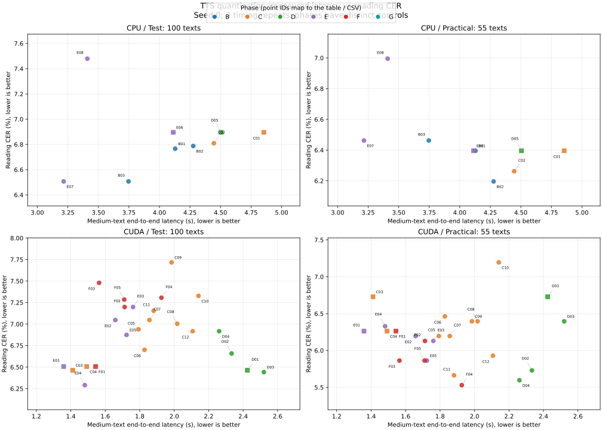

# exp0003: 量子化

このREADMEにはA〜Gの計画と各段階の概要を記載する。
Cの12条件を横断する結果表と、calibration・実装・評価上の制約の詳細は、[Cの詳細レポート](C_REPORT.md)を参照。

本文は、結論、計画と進捗、実行方法、A〜Fの段階別結果、今後の検証の順にまとめる。

## 結論: 結局どの条件を選ぶか(A〜F)

**QATは現時点の採用候補には必須ではない。** Fは、T2SまでINT4へ圧縮する場合の品質回復・劣化・追加学習コストを調べる検証として実施した。今回の200 stepではQAT固有の優位を確認できず、採用しない。[必要性の見解と比較条件](#f-qatの必要性と固定予算での検証)を参照。

本exp内の採用候補は、GPUの定常速度優先ならONNX Runtime FP32、PyTorch内での速度・VRAMのバランスならBF16、CPUの速度優先ならT2S＋S2Mの動的INT8。
重みファイルを最小化する場合はONNX Runtime INT4、PyTorch内で少し圧縮しつつ読みを維持したい場合はS2MのみINT4を検討する。

| 優先するもの | 推奨条件 | 判断理由・引き換えになるもの |
|---|---|---|
| GPUでの定常速度（ORT部分移植を許容） | ONNX Runtime FP32(G) | Gの中文でPyTorch FP32 1.308→1.122秒、テスト/実用文CERは両方6.46%/6.73%。export・runtime統合は必要 |
| PyTorch内での速度・読みCER・VRAMのバランス | GPU BF16 | FP32比でpeak VRAMが565→347 MiB。中文は1.411→1.492秒で、テストCERは6.46→6.51% |
| CPUでの速度 | T2S＋S2Mの動的INT8(B) | 10回計測の中文medianが4.474→3.200秒。2 seed平均の読みCERにも悪化は見られなかった。RAM削減は得られない |
| PyTorch内で読みを維持しつつ、重みを少し圧縮 | GPU S2MのみINT4・T2SはBF16(E) | BF16基準から181.0→142.4 MiB。中文1.36→1.48秒、テストCER 6.51→6.29%、実用文6.26→6.33%。VRAM削減はほぼない。単一seedでの候補 |
| 配布する重みファイルの小ささ | ONNX Runtime INT4(G) | ONNX graph＋残したT2S/S2M重みで約68.8 MiB。GPU中文1.199秒、テスト/実用文CER 6.74%/5.46%。GのFP32比でテストは約+0.28pt。runtime依存と読みの劣化を許容する用途向け |
| 元モデルの数値的な変更を抑える | FP32 | 低精度化による近似を加えない。読みCERが全評価集合で最良という意味ではない |

**読みの正確さだけでの総合1位は、まだ決めない。** Cのseed 0ではテスト100文はGPU FP32(6.46%)、
実用文55文はMSLK RTN INT4→tile(5.66%)が最小で、評価集合によって順位が変わった。
実用文に特化する場合は後者が候補だが、テストCER 7.16%への悪化もあるため、対象文章で再評価してから選ぶ。
CERは発音の誤りの指標であり、自然さ・抑揚・ノイズ等の聴感品質は未評価。

AWQ/GPTQを一律の既定には採用しない。今回の少量calibrationでは安定した優位が得られず、追加の変換・実装コストもある。
CPUのRAM削減を目的とする場合も、現状の測定から推奨できる量子化条件はない。
これらは現在のモデル・CPU/GPUでの暫定推奨であり、GやNNボコーダ導入後に更新する。
ファイルサイズはT2S＋S2Mのみで、codec・runtimeを含む配布物全体のサイズではない。

**Dを加えても、速度重視の推奨はGPU FP32・CPU動的INT8のまま。** GPU静的INT8/SmoothQuantは約106 MiBに縮小できるが、
今回のコンパイル実装で中文2.26〜2.52秒と、eager FP32の約1.36秒より遅い。
SmoothQuant α=0.5はテストCER 6.44%・実用文6.40%で、Dの同条件FP32(6.46%・6.73%)に対して読みの悪化は見られなかった。
ただし差は小さく、単一seed・calibration 8文の結果なので、品質改善の確証とはしない。
CPU静的INT8は中文で約8.6倍遅く、採用しない。CPU SmoothQuantは同じ演算経路のため追加測定しない。

## 計画と進捗

A〜Eは学習不要のPTQ(post-training quantization)を扱う。
FのQAT(quantization-aware training)は量子化誤差を模擬して追加学習する方式。200 stepの固定予算で追加学習対照と比較済み。

各候補の採否は速度と読みCERを必ず組み合わせて判断する。速度測定だけ済んだ条件は「品質未判定」と表示する。
CERは基準と候補の絶対値、およびポイント差を記録する。部品誤差・有限値検査・MP3はCERの代わりにはしない。
量子化範囲・backend・精度・QAT学習条件を変えた場合は、変更後の条件で速度とCERの両方を再評価する。

| 段階 | 条件 | 目的 |
|---|---|---|
| A | CPU FP32、S2Mのみ動的INT8 | 変換・推論・計測・サンプル出力の動作確認 |
| B | T2Sのみ、S2Mのみ、両方のCPU INT8 | 部品ごとの寄与と劣化箇所を分離 |
| C | CPU/GPU対応backendの重みのみINT8・INT4、AWQ系・GPTQ系 | 単純な重み量子化と、calibrationで誤差を抑える方式を比較 |
| D | 活性値も量子化する静的PTQ、SmoothQuant系 | calibrationデータと外れ値処理の影響を比較 |
| E | 敏感な層をFP32/FP16に残す混合精度(C/Dの各方式と併用) | 小さいサイズと品質維持の両立 |
| F | QATによる追加学習(AWQ/GPTQ/SmoothQuantの学習不要PTQとは別) | PTQでの品質低下を回復できるか |
| G | ONNX等の配布runtimeへ移行 | Python上の結果がブラウザ・エッジでも成立するか |

各段階の具体的なbackendと対応dtypeは、実環境で実行できるかを確認して記録する。
全手法を無条件に総当たりせず、非対応・実利のない条件も理由を残して絞り込む。
GPUで非対応の条件はCPUの数値で代用しない。ボコーダは学習済み版が用意できてから量子化対象へ追加する。

### 実施状況

| 条件 | 速度 | CER | 採用判断 |
|---|---|---|---|
| CPU FP32 / S2M動的INT8 | 代表3文・3回測定済み | 100＋55文のseed 0対比較済み | CER劣化なし。複数seed・聴感は未確認 |
| CPU T2S動的INT8 | 代表3文・3回測定済み | 100＋55文のseed 0対比較済み | 小差あり。複数seed・聴感は未確認 |
| CPU 両方INT8候補 | 代表3文・10回、独立process RAM測定済み | 100＋55文のseed 0・1対比較済み | 今回CER劣化なし。RAMは増加。聴感は未確認 |
| C: 重みINT8/INT4・group size・AWQ・GPTQ | 基準を含む12条件で速度・サイズ・メモリ測定済み | 100＋55文のseed 0評価済み | 選定条件の比較完了。[詳細レポート](C_REPORT.md) |
| D: 静的PTQ・SmoothQuant | GPU4条件・CPU基準の速度・サイズ・メモリ測定済み | 同5条件の100＋55文・seed 0評価済み | 比較完了。CPU静的INT8は速度で除外・CER未評価、CPU SmoothQuantは未実施 |
| E: 部品・層の混合精度 | GPU5・CPU3条件で速度・サイズ・メモリ測定済み | 全8条件で100＋55文・seed 0評価済み | 比較完了。GPUはS2MのみINT4が圧縮候補、CPUは全体動的INT8を維持 |
| F: QAT・同予算の追加学習 | 200 stepの2学習条件、GPU5推論条件で速度・サイズ・メモリ測定済み | 全5条件で100＋55文・seed 0評価済み | 比較完了。今回QAT固有の優位なし・不採用 |
| G: ONNX Runtimeと量子化 | CPU4・GPU3条件を計測中 | 評価予定 | export・可変長・provider検査完了 |

### 比較条件の固定

- FP32 eagerを基準とし、コンパイル等を組み合わせる前に量子化単独の効果を測る
- 生成step・温度・CFG・seed列・入力・batch・CPU thread数をそろえる
- calibrationとQATに評価文を使わず、学習splitから取り出す。選定規則・件数・seedを記録する
- calibrationは短文だけに偏らないよう長さを分け、反復型部品では異なる時刻の活性値も対象にする
- calibration用の重い特徴抽出は必要性を確認してから行い、推論にHuBERTを追加しない
- 量子化範囲、除外層、per-tensor/per-channel、scale、zero point、group size、重み/活性値/cacheのdtypeを明記する
- T2Sでは重みを直接参照する実装があるため、Linearの置換だけで動くか確認する。除外した層は記録する

### 精度と品質

1. 固定入力の部品単独出力: 最大絶対誤差、RMSE、相対L2、NaN/Inf
2. 上流を固定: 同一のテキストID、同一音声トークン、同一ノイズから対象部品を比較する
3. 全体生成: テスト100文と実用文55文の読みCER、失敗数、生成音声長、極端な長短・繰り返しを確認する
4. 良い候補は複数seedで再評価し、小差を1回の偶然で採用しない
5. 同じ文章・seedのMP3を出し、数値に出ないノイズ・発音・抑揚の差を比較できるようにする

Griffin-Limを使う期間はその音質上限を明示し、UTMOS等の改善・劣化だけで量子化の採否を決めない。

### 性能とサイズ

- 区間別時間、全体時間、RTF、median/p90、cold load、変換時間
- peak RSS/VRAM、重みのserializeサイズ、runtime込みの配布サイズを分ける
- CPU thread数とbackend、GPU kernel対応、実際に量子化された層数を記録する
- weightだけ圧縮しても実際のkernelが速くならない場合は、圧縮の成果と速度の成果を分ける
- warm-upと計測回数を条件間で固定する。正式比較は初期3回から増やし、必要なら別processでも再測定する

### QAT

PTQで劣化する部品を優先する。まず元checkpointから小規模な追加学習を試し、学習データ・step・optimizer・LR・seed・時間を記録する。
同じ予算で量子化なしの追加学習も比較し、追加学習そのものの効果とQATの効果を区別する。
fake quantでの検証に加え、実際の量子化kernelへ変換した後の品質・速度も評価する。
学習checkpointはGit管理外に置き、公開するのはレポート・集計JSON・少数のMP3に限定する。

### MP3の容量管理

初期条件は3文のみ。正式候補には既存実験と同じ代表文を追加し、全155文の音声を公開用へコピーしない。
48kbpsなら1分あたり概ね360KBなので、条件数と総秒数を記録して公開容量を管理する。
一覧JSONの条件IDは量子化方式・対象部品・deviceを区別できるものにする。

## 実行方法と出力

```bash
python run.py --device cpu
python run.py --device cpu --quantize
python run.py --device cuda
```

短・中・長文、8 threads、warm-up 1回、3回計測。同一条件の最終run(seed 3)を48kbps MP3として保存する。
音声エンコードは計測区間外。各条件3文のみとし、波形・重みはGitへ追加しない。
サンプル一覧は`results/samples/index.json`で、既存試聴ページと同じ形式。
MP3は生成波形から直接エンコードする。

初期のAではS2M、B以降ではT2S＋S2Mのstate_dictサイズを記録する。TTS全体やruntime込みの配布サイズとは異なる。
3文の有限値検査・試聴サンプルだけでは品質維持を結論づけない。100文CER等の評価は別途実施する。

## A: CPU S2Mの動的INT8

### 速度とサイズ

CPU: Core Ultra 7 265K、8 threads。GPU: RTX 5090。FP32モデルを基準に、CPUではS2MのLinearだけを動的INT8へ変換。
生成条件はexp0001と同一。warm-up 1回・3回計測のmedianで、正式候補の評価前の動作確認とする。

| 入力 | CPU FP32 全体 | CPU INT8 全体 | CPU FP32 S2M | CPU INT8 S2M | GPU FP32 全体 |
|---|---:|---:|---:|---:|---:|
| 短文 | 1.120秒 | 1.012秒 | 0.444秒 | 0.327秒 | 1.487秒 |
| 中文 | 4.855秒 | 4.129秒 | 2.407秒 | 1.706秒 | 1.706秒 |
| 長文 | 13.070秒 | 11.326秒 | 7.481秒 | 5.795秒 | 1.581秒 |

S2M state_dictは162,901,299→46,491,967 bytes(約71.5%減)。CPU全体は約10〜15%短縮した。
これはA段階のCPU用dynamic INT8の結果。GPUの重みINT8はCで別途評価した。
動的INT8はLinearの重みを量子化し、活性値の量子化を実行時に行う。静的calibrationやQATは今回使っていない。
全3条件で生成Mel・波形は有限値。CPUのCER・中間出力の誤差は次節で評価した。聴感は未確認。

MP3は3条件×3文で計9本、合計376,272 bytes(約367 KiB)。同じseed 3の生成を48kbpsで保存した。
`site/manifest.json`に「TTS 推論最適化」を追加し、既存GitHub Pagesの試聴UIで比較できる一覧を登録した。
聴感による品質評価は未実施。

### CERと部品出力の誤差

`evaluate.py`ではCPUのT2Sを1回だけ実行して両条件で同一の音声トークンを使い、S2Mの初期ノイズも固定する。
S2M batch 4、seed 0で100テスト文＋55実用文を比較し、同じGPU ASRで読みCERを計算する。
これはS2M量子化の効果を分離する品質比較で、exp0001のbatch 16のCERと厳密には同条件でない。
速度はASRを含まない別計測。評価WAVはGit管理外の`runs/quality/`、集計は`results/quality.json`へ保存する。

x86 backend、45個のLinear、qint8重み・per-tensor affine量子化。
変換層一覧は`results/quality.json`に保存した。T2S・codec・Griffin-LimはFP32のまま。
両条件で同じ音声トークンとS2Mノイズを使い、CPU S2M batch 4、seed 0で対比較した。

| 条件 | テスト100文 読みCER | FP32との差 | 実用文55文 読みCER | FP32との差 |
|---|---:|---:|---:|---:|
| CPU FP32 | 6.90% | 基準 | 6.40% | 基準 |
| CPU S2M動的INT8 | 6.77% | -0.13pt | 6.40% | 0.00pt |

このseedでは読みCERの劣化はなかった。小差であり、改善の有意性や音質維持を結論づけない。
FP32の数値がexp0001と違うのは、CPU実行・batch・乱数の使われ方が異なるため。量子化の差はこの対比較内で判断する。

合成テンソルでのS2M単発出力誤差は最大絶対値0.252、RMSE 0.0604、相対L2 4.26%。
これは実データ分布を保証しない補助検査。実際の同一トークン・ノイズから生成したlog-Melの相対L2誤差の中央値は、
テスト文0.932%、実用文0.841%だった。全生成のMel・波形は有限値。
Melの数値誤差をそのまま知覚音質の劣化率と解釈しない。

```bash
python evaluate.py
```

## B: 量子化対象部品の比較

同じCPU動的INT8で、T2Sのみ・S2Mのみ・両方を比較する。
T2Sではdevice取得用に`head.weight`を参照するため出力`head`をFP32に残す。Embedding、Conv、LayerNormも対象外。
T2Sの68個のLinear、S2Mの45個のLinearを変換する。除外層と変換名は各結果JSONへ保存する。
ここでの「T2S INT8」は全演算INT8という意味ではない。

| CPU条件 | 短文 全体 | 中文 全体 | 長文 全体 | T2S state | S2M state | テスト100文CER | 実用文55文CER |
|---|---:|---:|---:|---:|---:|---:|---:|
| FP32 | 1.120秒 | 4.855秒 | 13.070秒 | 206.6 MiB | 155.4 MiB | 6.90% | 6.40% |
| S2M INT8 | 1.012秒 | 4.129秒 | 11.326秒 | 206.6 MiB | 44.3 MiB | 6.77% | 6.40% |
| T2S INT8 | 0.931秒 | 4.277秒 | 12.284秒 | 60.4 MiB | 155.4 MiB | 6.79% | 6.20% |
| 両方INT8 | 0.940秒 | 3.747秒 | 10.548秒 | 60.4 MiB | 44.3 MiB | 6.51% | 6.46% |

短文で両方INT8が最速ではない差は小さく、3回計測のばらつきとしても考えられる。両方INT8候補の10回計測結果は次節に示す。
T2S stateは216,661,159→63,355,479 bytes。表のサイズは各部品のstate_dictで、codec・runtimeを含む全体容量ではない。
生成サンプルを各3文追加した。公開用の全評価音声コピーや重みの保存は行わない。

BのCERは量子化T2Sで100＋55文の共通トークンを生成し、それをFP32/INT8のS2Mへ渡す。
Aと同じseed・batch設定で、T2Sの量子化によるトークン・長さの変化を含めて比較する。
BのMel誤差は「量子化T2Sを共有した上でのS2M差」であり、FP32 T2Sからの全体誤差とは異なる。

両方INT8はFP32比で中文約23%、長文約19%短縮。テストCERは-0.39pt、実用文は+0.07ptだった。
単一seedの小差なので精度改善や同等性の統計的な保証はしない。全条件のMel・波形は有限値。
T2SのみINT8は実用文で-0.20ptだが、これも改善と断定しない。
量子化によるサイズ削減は明確だが、この初期比較ではpeak RAMは未測定。次節の独立プロセス測定で確認した。

Bの品質結果は`results/quality_b.json`、速度は`cpu_t2s_int8.json`・`cpu_both_int8.json`。
MP3はGPU FP32を含む5条件×3文で計15本、合計634,608 bytes(約620 KiB)。中間結果は表で蓄積する。

```bash
python run.py --device cpu --target t2s
python run.py --device cpu --target both
python evaluate.py --t2s-int8
```

### 採用候補の追加検証: FP32と両方INT8

速度を各入力10回へ増やし、warm-up 1回、8 threads、同じseed列で独立プロセス測定した。
元の3回計測を上書きせず、結果は`results/validation/`へ保存する。

| 入力 | FP32 median / p90 | 両方INT8 median / p90 | median短縮率 |
|---|---:|---:|---:|
| 短文 | 1.063 / 1.122秒 | 0.784 / 0.797秒 | 約26% |
| 中文 | 4.474 / 4.607秒 | 3.200 / 3.279秒 | 約28% |
| 長文 | 12.241 / 12.496秒 | 9.787 / 10.012秒 | 約20% |

#### RAM

サイズ計測用のserialize bufferを作らない別プロセスで、モデルをロード・必要なら変換後に長文1件を推論した。
RSSはPython・ライブラリ・codec・全モデル・allocator等を含むprocess全体で、純粋な重みサイズではない。

| CPU条件 | load/変換後RSS | 長文推論後RSS | process peak RSS |
|---|---:|---:|---:|
| FP32 | 1.506 GiB | 1.544 GiB | 1.544 GiB |
| 両方INT8 | 1.587 GiB | 1.622 GiB | 1.622 GiB |

この実行方法ではINT8のpeak RSSは約5%増えた。FP32 checkpointからその場で変換する処理や、
allocatorが保持する領域を含むため、重みserializeサイズの減少からprocess RAM削減を結論づけられない。
量子化済みcheckpointの直接ロードやallocator条件を変えた場合は別測定が必要。今回は各条件1プロセスのみ。

#### seed 0・1のCER

| seed | FP32 テストCER | 両方INT8 テストCER | FP32 実用文CER | 両方INT8 実用文CER |
|---|---:|---:|---:|---:|
| 0 | 6.90% | 6.51% | 6.40% | 6.46% |
| 1 | 7.98% | 6.81% | 5.93% | 5.33% |
| 2 seedの平均 | 7.44% | 6.66% | 6.16% | 5.90% |

seed 1でも全生成は有限値で、CER悪化は見られなかった。平均差はテスト-0.78pt、実用文-0.27pt。
seed 0の実用文は微増している。量子化により生成の確率・長さ・トークン列も変わり、
同じseedでも同じ出力にはならないため、2 seedの結果から量子化が精度を改善すると一般化しない。
基準FP32のテストCERにもseed間で約1.08ptの差があり、単一seedの小差を評価する難しさが分かる。

結果は`results/validation/quality_seed1.json`。seed 0はA/Bの`quality.json`・`quality_b.json`を使用した。
公開MP3は15本のまま。試聴ページのCERはseed 0の値を保持し、複数seed平均と混ぜない。

この候補は「CPU速度・配布重みサイズには効果あり、今回のCERは維持、実行時RAM削減は未達」と整理する。
Cでは重みのみINT8/INT4と同じ軸で比較する。

```bash
python run.py --target none --repeats 10 --no-samples --output-dir results/validation
python run.py --target both --repeats 10 --no-samples --output-dir results/validation
python check_memory.py
python check_memory.py --quantize
python evaluate_candidate.py --seed 1
```

## C: 重みのみINT8/INT4と、calibrationを使う方式

最初にtorchaoの単純な重みのみINT8/INT4を測り、次にAWQ系・GPTQ系を比較する。
今回追加したbackendはtorchao 0.18.0。PyTorch 2.14.0+cu130等の既存パッケージは変更していない。

### backend・dtypeの事前確認(C1時点)

| 重み方式 | CPU | GPU | 備考 |
|---|---|---|---|
| Int8WeightOnlyConfig | FP32/BF16の単体Linearで動作 | FP32/BF16の単体Linearで動作 | 本計測ではFP32と比較 |
| Int4WeightOnlyConfig・plain | 依存不足で失敗 | 依存不足で失敗 | C1時点ではmslk不足。C3で追加し、packing変換後の推論を評価 |
| Int4WeightOnlyConfig・tile-packed | 今回の経路では動作せず | BF16で動作 | FP32は未対応。CPUではCUDA/driverを要求する経路に入った |

CPU全体としてINT4非対応という結論ではなく、今回のconfig・経路での結果である。
失敗条件も`results/weight_only/probe_*.json`に保存する。

INT4はgroup size 128、TILE_PACKED_TO_4D、TINYGEMMで、単純なgroup-wise PTQ。
C1ではAWQ/GPTQを使用しない。group境界に合わないS2Mの`in_proj`等を高精度に残す。
T2Sの`head`もBと同様に除外し、量子化・除外層の一覧を結果へ保存する。
INT4の速度・品質は、同じBF16 model/activationの基準と比較してdtype変更の影響を分ける。
Griffin-Limは引き続きFP32で、量子化対象にしない。

計測はeagerのまま。コンパイルとの組合せは別条件とし、量子化単独と混ぜない。
各条件3文のMP3を追加し、同じ100テスト文＋55実用文のCERを評価する。中間結果は表に蓄積する。

参照: [Int8WeightOnlyConfig](https://docs.pytorch.org/ao/stable/api_reference/generated/torchao.quantization.Int8WeightOnlyConfig.html)、
[Int4WeightOnlyConfig](https://docs.pytorch.org/ao/stable/api_reference/generated/torchao.quantization.Int4WeightOnlyConfig.html)。
実際のAPIはインストール済み0.18.0のsignatureと実行結果でも確認した。

### C1: 単純な重み量子化の初期結果

速度は8 threads、batch 1、warm-up 1回・計測3回のmedian。
品質はseed 0、T2S batch 16・S2M batch 4、100テスト文＋55実用文。dtypeをそろえた基準との差を見る。
AWQ/GPTQを使わない重み量子化なので、calibrationデータは不要だった。
量子化対象はINT8でT2S 68層・S2M 45層、INT4ではT2S 67層・S2M 44層。
INT4のS2M `in_proj`とT2S `head`・`duration.out`は高精度のまま。正確な除外一覧は各JSONへ保存した。
重みINT8はper-row。A/Bの動的INT8はper-tensor重みなので、両者の差を活性値量子化の有無だけに帰属させない。

| GPU条件 | 短文 | 中文 | 長文 | T2S＋S2M state | テストCER | 実用文CER |
|---|---:|---:|---:|---:|---:|---:|
| FP32 | 1.356秒 | 1.411秒 | 1.484秒 | 362.0 MiB | 6.46% | 6.73% |
| 重みINT8・FP32 activation | 1.730秒 | 1.793秒 | 1.805秒 | 105.5 MiB | 6.94% | 6.20% |
| BF16基準 | 1.527秒 | 1.492秒 | 1.475秒 | 181.0 MiB | 6.51% | 6.26% |
| 重みINT4・BF16 activation | 1.882秒 | 1.856秒 | 1.924秒 | 90.4 MiB | 7.05% | 6.20% |

GPUのINT8・INT4とも今回のeager実行では高速化しなかった。INT4はBF16基準からstateサイズを約50%削減したが、
テストCERが+0.54pt、実用文は-0.07ptだった。INT8のテストCERもFP32比+0.48pt。
単一seedなので有意差は未判定だが、「小さくなれば速くなる」「低bitでも品質は常に維持される」とは扱わない。
この結果は方式共通の結論ではなく、当該モデル・eager backend・GPU・入力での観測である。
Cではeager実行を比較した。静的INT8とコンパイルの組合せはDに示す。

CPUの重みINT8も100＋55文のCER評価を完了した。A/BのFP32と動的INT8を参考として並べる。

| CPU条件 | 短文 | 中文 | 長文 | T2S＋S2M state | テストCER | 実用文CER |
|---|---:|---:|---:|---:|---:|---:|---:|
| FP32(A/Bの3回基準) | 1.120秒 | 4.855秒 | 13.070秒 | 362.0 MiB | 6.90% | 6.40% |
| 動的INT8・両部品(Bの3回) | 0.940秒 | 3.747秒 | 10.548秒 | 104.8 MiB | 6.51% | 6.46% |
| 重みのみINT8・両部品(C1) | 1.077秒 | 4.445秒 | 11.766秒 | 105.4 MiB | 6.81% | 6.26% |

CPU重みINT8はseed 0でFP32比テスト-0.09pt、実用文-0.13pt。全条件で生成Mel・波形は有限値。
CPUの初期速度表では動的INT8の方が速かったが、時刻・計測回数の違いも考慮する。
実際、別の10回検証でFP32の中文medianは4.474秒だったため、C1重みINT8の4.445秒という小差を高速化とは断定しない。
GPU INT8はFP32基準比、INT4はBF16基準比で比較する。CPU/GPU間で同じseedでも出力が完全一致するとは限らない。
C全体のメモリ結果は[詳細レポート](C_REPORT.md)を参照。Cの全条件に対する複数seed評価は未実施で、Bの動的INT8の結果を転用しない。

品質は`results/weight_only/quality_*.json`、速度は同ディレクトリの条件別JSONに保存した。
GPUの基準もC1で再計測した。公開MP3は全9条件×3文で27本、合計1,136,304 bytes(約1.08 MiB)。
公開MP3は各条件3文。中間結果は表のみで、散布図は多数の条件を終えた後の総括で作成する。

再現例:

```bash
python run.py --device cpu --target both --wo-bits 8 --output-dir results/weight_only
python run.py --device cuda --target both --wo-bits 8 --output-dir results/weight_only
python run.py --device cuda --dtype bfloat16 --output-dir results/weight_only
python run.py --device cuda --target both --wo-bits 4 --dtype bfloat16 --output-dir results/weight_only
python evaluate_weight_only.py --device cuda --bits 4 --dtype bfloat16
```

### C2/C3: group size・AWQ・GPTQの比較(完了)

group size 32/64/128、AWQ INT4、GPTQ INT8/INT4と対応する基準を追加した。
選定した12条件で速度・100＋55文CER・重みサイズ・独立プロセスのメモリ計測を完了した。
結果表、calibrationの条件、backendの制約は[C完了レポート](C_REPORT.md)にまとめた。
集計元データは`results/weight_only/c_summary.csv`・`c_summary.json`。
group sizeは量子化対象層をそろえて比較し、層ごとの混合精度はEで扱う。

## D: 静的PTQ・SmoothQuant

DではLinearの重みと活性値をINT8にする静的PTQを対象とする。
平滑化なし、SmoothQuant α=0.5、α=0.75を、CPU/GPUそれぞれのFP32基準と比較する。
重みはper-row、活性値はper-tensor・対称量子化で、calibration後は活性値のscaleを固定する。
T2Sの出力head、出力次元が8の倍数でないLinear、codec、LayerNorm、attentionのsoftmax、暫定ボコーダは量子化対象外。
出力次元の制約はGPU INT8 GEMMに合わせ、CPUにも同じ対象範囲を適用する。

GPUのeager静的INT8は中文で50.035秒、同FP32は1.356秒となり、実用候補から外した。
以降はLinearだけを`torch.compile(fullgraph=True, dynamic=True)`でコンパイルし、FP32にも同じ処理を適用する。
GPUの16行以下の入力は32行へゼロ埋めし、Linear後に余分な行を除く。attentionへは余分な行を渡さない。
初回コンパイルを含むwarmup時間は定常速度と別に記録する。A〜Cのeager結果とは直接同列に比較しない。

CPU静的INT8は短文5.328秒・中文38.554秒で、同条件FP32の1.275秒・4.505秒に対して約4.2倍・8.6倍遅かった。
このtorchao CPU INT8演算経路は速度で不採用とし、長文反復とCER評価を省略した。
同じ演算経路を使うCPU SmoothQuantの2条件も追加測定しない。CPUの品質維持は未判定であり、静的INT8一般や他runtimeへの否定ではない。

calibrationは学習splitのテキスト8文を長さ別に選び、2 passでチャネル別の最大絶対値と平滑化後の範囲を求める。
評価文は使用せず、CPU/GPUの参照入力をそれぞれキャッシュして同じdevice内の3方式で共有する。
T2Sのマスク率とS2Mの時刻を変えた近似状態を観測し、全生成軌跡の収集は行わない。
GPU/CPUの両方で速度・100＋55文CER・独立プロセスのメモリを測り、代表3文を48kbps MP3に保存する。
測定手順は`finish_d.py`、変換処理は`static_models.py`。既存結果は上書きせず、`results/static/`に保存する。
集計は[`d_summary.csv`](results/static/d_summary.csv)・[`d_summary.json`](results/static/d_summary.json)、
表の再生成と試聴ページの条件登録には、集計スクリプト[summarize_d.py](summarize_d.py)を使う。

<!-- D_RESULTS_START -->
| Device | 条件 | 中文 秒 | テストCER % | 実用文CER % | 重み MiB | peak RSS MiB | peak VRAM MiB |
|---|---|---:|---:|---:|---:|---:|---:|
| cuda | FP32 | 2.42 | 6.46 | 6.73 | 361.98 | 2665.66 | 565.33 |
| cuda | 静的INT8 | 2.33 | 6.66 | 5.73 | 105.52 | 2665.59 | 311.22 |
| cuda | SmoothQuant α=0.5 | 2.52 | 6.44 | 6.40 | 105.88 | 2676.59 | 311.55 |
| cuda | SmoothQuant α=0.75 | 2.26 | 6.92 | 5.60 | 105.88 | 2671.49 | 311.55 |
| cpu | FP32 | 4.50 | 6.90 | 6.40 | 361.98 | 1778.07 | — |
| cpu | 静的INT8 | 38.55 | — | — | — | — | — |
| cpu | SmoothQuant α=0.5 | — | — | — | — | — | — |
| cpu | SmoothQuant α=0.75 | — | — | — | — | — | — |
<!-- D_RESULTS_END -->

## E: 高精度に残す部品・層の比較

GPUはBF16基準、両部品INT4、T2SのみINT4、S2MのみINT4、入出力側をBF16に残す混合精度の5条件。
INT4はCと同じ単純な重み量子化・group size 128・Tinygemmで、活性値はBF16とする。
CPUはFP32基準、両部品の動的INT8、入出力側をFP32に残す混合精度の3条件。
Dで遅かったCPU静的INT8と、今回の経路では未対応のCPU INT4は使用しない。

入出力側を残す条件では、T2S・S2Mそれぞれの最初と最後のTransformer block、およびblock外のLinearを高精度で保持する。
T2Sではテキストエンコーダと長さ予測器もblock外に含まれるため、高精度に残す範囲は単なる入力・出力の1層だけではない。
これは構造に基づく事前定義の比較であり、感度測定で特定した層という意味ではない。
評価集合のCERを使って残す層を選ばない。量子化・除外層の一覧は各JSONへ記録する。

速度は短・中・長文、8 threads、batch 1、warmup 1回・3回計測。
CERはseed 0、T2S batch 16・S2M batch 4、テスト100文＋実用文55文で基準も再評価する。
メモリは別プロセスで測り、各条件の同じ代表3文を48 kbps MP3で出力する。
生成step・CFG・暫定ボコーダはA〜Dと同じ。コンパイルは使用しない。

実行は`finish_e.py`、層の選択は`mixed_models.py`。結果は`results/mixed/`、評価音声はGit管理外の`runs/mixed_audio/`へ保存する。
GPU5条件・CPU3条件の速度、100＋55文CER、サイズ、独立プロセスのメモリ測定を完了した。
集計元は[`e_summary.csv`](results/mixed/e_summary.csv)・[`e_summary.json`](results/mixed/e_summary.json)。
表と試聴ページの条件登録は[summarize_e.py](summarize_e.py)で再生成できる。

### 採用判断

S2MのみINT4は、BF16基準に対して重み181.0→142.4 MiB、中文1.36→1.48秒、
テストCER 6.51→6.29%、実用文6.26→6.33%。速度よりも、読みを保ちながら少し圧縮したい場合の候補となる。
ただしpeak VRAMは347.3→344.5 MiBとほぼ減らず、主な利点は配布する重みファイルの圧縮である。
T2SのみINT4はテストCER 7.20%まで悪化し、中文1.76秒とS2MのみINT4より遅かった。
今回の低bit化ではT2S側の影響が大きい。ただし単一seedの部品単位比較であり、層ごとの感度順位ではない。

入出力側をBF16に残す条件は、両部品INT4よりテストCERが7.05→6.87%へ改善した一方、
重み90.4→124.1 MiB、中文1.66→1.72秒となった。全用途の既定としては採用しない。
最小ファイル優先では両部品INT4、GPUの速度優先では高精度基準を選ぶ方針を維持する。
いずれも100＋55文・seed 0での観測で、聴感品質と複数seedでの再現性は未確認。

CPUでは両部品の動的INT8を維持する。FP32に対して中文4.11→3.22秒、重み362.0→104.8 MiBで、
テストCER 6.90→6.51%、実用文6.40→6.46%だった。入出力側をFP32に残す条件は中文3.41秒、重み200.0 MiB、
CER 7.48%・7.00%となり、全体INT8より遅く、大きく、読みも悪化したため採用しない。
同じseedでも高精度に戻すことで生成する長さ・トークン・乱数の使われ方が変わるため、部分的に精度を上げればCERが必ず良くなるとは限らない。
CPU peak RSSもFP32約1639 MiBに対して全体INT8約1778 MiB・混合精度約1885 MiBで、RAM削減は得られなかった。

Eの結論は、GPUでは圧縮と読みのバランス候補としてS2MのみINT4を追加し、CPUは全体動的INT8を維持すること。
構造で選んだ入出力側の高精度化は既定にしない。全層の感度探索や全組合せの最適性を示す結果ではない。

### 速度・CER・サイズ・メモリ

<!-- E_RESULTS_START -->
| Device | 条件 | 中文 秒 | テストCER % | 実用文CER % | 重み MiB | peak RSS MiB | peak VRAM MiB |
|---|---|---:|---:|---:|---:|---:|---:|
| cuda | BF16基準 | 1.36 | 6.51 | 6.26 | 181.04 | 2773.39 | 347.28 |
| cuda | 両部品INT4 | 1.66 | 7.05 | 6.20 | 90.39 | 2788.51 | 292.73 |
| cuda | T2SのみINT4 | 1.76 | 7.20 | 6.13 | 128.99 | 2778.07 | 297.02 |
| cuda | S2MのみINT4 | 1.48 | 6.29 | 6.33 | 142.44 | 2779.85 | 344.52 |
| cuda | 入出力側BF16・他INT4 | 1.72 | 6.87 | 5.86 | 124.06 | 2789.03 | 324.84 |
| cpu | FP32基準 | 4.11 | 6.90 | 6.40 | 361.98 | 1638.59 | — |
| cpu | 両部品動的INT8 | 3.22 | 6.51 | 6.46 | 104.76 | 1777.69 | — |
| cpu | 入出力側FP32・他動的INT8 | 3.41 | 7.48 | 7.00 | 200.02 | 1885.35 | — |
<!-- E_RESULTS_END -->

## F: QATの必要性と固定予算での検証

### 現時点でQATは必要か

**現在の採用候補にはQATは必須ではない。** GPUの速度優先ではFP32/BF16を選べ、CPU動的INT8にも追加学習は不要だった。
GPUの重み圧縮でもS2MのみINT4という選択肢がある。INT4化は今回のGPUで高速化につながらず、QATを加えても同じbit幅・kernel自体が速くなるわけではない。
QATには追加学習と保守のコストがあるため、現状の既定手段としては推奨しない。

一方、**T2SまでINT4にして配布サイズをさらに削る必要がある場合**は検討余地がある。
EのT2SのみINT4はテストCERがBF16の6.51%から7.20%へ悪化したため、その劣化を追加学習で回復できるかを測る。
Fは現状の採用に不可欠な最適化ではなく、QATによる品質回復・逆の劣化・追加学習コストを把握するための検証として実施する。
結果が良くても、少量・短時間の追加学習だけでQAT一般の有効性や不要性を断定しない。

### QATと模擬量子化の仕組み

QATでは、量子化で生じる丸め誤差を学習中から再現する「模擬量子化(fake quantization)」が一般的に使われる。
「量子化(FP32の重み→INT4整数コード)」と「逆量子化(整数コード→丸め誤差を含む浮動小数点値)」を続けて行い、その値で出力と損失を計算する。
例えば説明用にスケールを0.1とすると、重み0.263を整数コード3へ丸め、逆量子化した0.300で計算する。元の0.263には戻らず、丸め誤差は残る。

丸めはそのままでは通常の勾配学習ができないため、逆伝播では丸めの微分を1として勾配を通すSTE(Straight-Through Estimator)という近似を使い、保持する重みを更新する。
今回もこの方法で、FP32の主重みから128個ごとにINT4の16段階へ丸めた値を作り、BF16で計算して学習した。
学習後は重みを実際の4bit形式へ変換し、INT4対応kernelで速度とCERを評価した。

学習済みモデルから追加学習するQATと、初期化モデルから学習するQATの両方がある。今回は前者であり、通常の追加学習後に初めて量子化する「追加学習後PTQ」と区別する。

### 比較条件と学習予算

| 条件 | 追加学習 | 推論するT2S | 比較する目的 |
|---|---|---|---|
| BF16基準 | なし | 元の重み・BF16 | 元モデルの精度・速度 |
| PTQ INT4基準 | なし | 元の重みをINT4変換 | 学習なしの圧縮による劣化 |
| 量子化なし追加学習 | 200 step | 追加学習した重み・BF16 | 追加学習自体の効果と劣化 |
| 追加学習後PTQ | 同じ200 step | 量子化なしで追加学習した重みをINT4変換 | QAT固有の効果を分離 |
| QAT後INT4 | 同じ200 step | 模擬量子化して学習した重みを実INT4へ変換 | 品質回復・逆の劣化を比較 |

既存の日本語HuBERT codecの音声トークンキャッシュ、学習テキスト、音素アライメントを使う。学習時の音声・Mel再読込やHuBERT再実行は不要。
train splitから長さ別に512文、独立したval splitから64文をseed 0で選び、音素ラベルが一致しない文を除外する。実際のID・件数は結果JSONに記録する。
評価用100＋55文は学習・checkpoint選択に使わない。
追加学習とQATは同じ元checkpoint、データ順、seed、200 step、AdamW、最大学習率1e-5、warmup 20 step、weight decay 0.01、勾配clip 1.0、max tokens 4096を使う。
FP32の主重みとBF16 autocastで学習し、最終200 stepを固定して評価する。初期および50 stepごとのval lossも記録する。
アライメント不一致を除いた実数はtrain 478文・val 61文で、両条件のIDと元checkpointのhashが同一であることを確認した。

INT4はEと同じT2SのLinearを対象とし、group size 128、非対称量子化、BF16 scale・浮動小数zero pointを使う。
headと形状非対応の層は高精度に残し、S2Mは全条件BF16で固定する。推論は模擬量子化のままではなくTinygemm用の実INT4へ変換して測る。
このINT4 backendはCUDA限定であるため、Fの同一方式のCPU速度・CERは未対応とする。CPUでの別runtimeのINT4対応はGで扱い、GPUの値をCPUに流用しない。

速度は代表3文・8 threads・batch 1・warmup 1回・3回計測、CERは100＋55文・seed 0・T2S batch 16・S2M batch 4で比較する。
独立プロセスでメモリを測定し、各条件3文の48 kbps MP3を保存する。学習時間・peak VRAM・val loss・実量子化の除外層も記録する。
学習checkpointと評価WAVはGit管理外の`runs/qat/`・`runs/qat_audio/`、公開する集計は`results/qat/`へ保存する。

追加学習・QATとも200 stepの学習と、GPU5条件の実推論評価を完了した。

| 学習条件 | 学習ループ＋途中検証 | peak VRAM | 初期val loss | 最終val loss |
|---|---:|---:|---:|---:|
| 量子化なし追加学習 | 14.3秒 | 1.84 GiB | 3.2009 | 3.1817 |
| QAT | 22.9秒 | 2.03 GiB | 3.2021 | 3.1829 |

時間はデータ準備・初期検証・QATモジュール構築を除く。学習コスト全体ではない。
val lossの低下だけで読みCERの維持や改善とは判定しない。

### 結果と採用判断

**今回の用途・学習予算ではQATを採用しない。既存のPTQ・高精度の採用候補を維持する。**
QAT後INT4はテストCER 7.28%・実用文5.86%で、元のBF16基準6.51%・6.26%に対し、テストは約0.78ポイント悪化した。
通常のPTQ(7.20%・6.13%)からもテストの劣化を回復できず、実用文だけでは改善した。
同予算の追加学習後PTQ(7.31%・5.53%)と比べると、QATのテスト差は約-0.02ポイントと小さく、実用文は約+0.33ポイント悪化した。
単一seed・少量データのため、QAT固有の改善を示す結果とは扱わない。

量子化なし追加学習でもテストCERは7.48%へ悪化した。したがって学習後の劣化をQATだけに帰属させず、元モデル・通常PTQ・追加学習対照との比較で判断する。
QATの重みサイズは通常PTQ・追加学習後PTQと同じ約129.0 MiBで、同じINT4 kernelを使う。
QATによってbit幅やkernelが変わるわけではなく、追加の圧縮や方式自体の高速化は得られない。

この結果は478文・200 step・seed 0での検証であり、長時間学習や別データでもQATが不要であることを証明しない。
ただし現状の速度・品質・配布サイズの選択肢を満たすためにQATを追加する必要性は認められず、回復・劣化・コストを調べるというFの検証目的を満たしたと整理する。
聴感と複数seedは未評価。QATとS2M INT4の同時適用は今回の対象外。

実行は`train_f.py --mode ft`・`train_f.py --mode qat`、推論評価は`finish_f.py`。
集計元は[`f_summary.csv`](results/qat/f_summary.csv)・[`f_summary.json`](results/qat/f_summary.json)、学習条件とIDは`results/qat/train_ft.json`・`train_qat.json`。
READMEの表と試聴条件の登録は[summarize_f.py](summarize_f.py)で再生成できる。

### 速度・CER・サイズ・メモリ

<!-- F_RESULTS_START -->
| Device | 条件 | 中文 秒 | テストCER % | 実用文CER % | 重み MiB | peak RSS MiB | peak VRAM MiB |
|---|---|---:|---:|---:|---:|---:|---:|
| cuda | BF16基準 | 1.54 | 6.51 | 6.26 | 181.04 | 2774.09 | 347.28 |
| cuda | T2S PTQ INT4 | 1.71 | 7.20 | 6.13 | 128.99 | 2784.37 | 294.64 |
| cuda | 追加学習 BF16 | 1.56 | 7.48 | 5.86 | 181.04 | 2778.30 | 347.38 |
| cuda | 追加学習後PTQ INT4 | 1.93 | 7.31 | 5.53 | 128.99 | 2784.84 | 294.96 |
| cuda | QAT後INT4 | 1.71 | 7.28 | 5.86 | 128.99 | 2785.96 | 295.19 |
<!-- F_RESULTS_END -->

## G: ONNX Runtimeでの量子化・実行互換性

Gはexp3の最後の段階として、量子化形式を別runtimeへ持ち込めるかを検証する。
T2Sのテキストエンコーダ・Transformer block群、S2Mのvelocity計算を可変長ONNX(opset 18)へ移し、生成ループ・codec・長さ調整・暫定ボコーダは共通のPyTorch実装に保つ。
全体をONNXだけで動かす移植はexp0004以降で扱う。今回のPython/CUDA結果だけでブラウザ対応済みとは判定しない。

CPUはPyTorch FP32、ONNX Runtime FP32、動的INT8、INT4の4条件。
GPUはPyTorch FP32、ONNX Runtime FP32、INT4の3条件で比較する。
ONNX Runtime 1.32.0のCPU/CUDA providerを使用し、GPUはTF32を無効にする。PyTorchとの受け渡しはI/O Bindingで行う。
速度は8 threads・代表3文・batch 1・warmup 1回・3回計測、CERは100＋55文・seed 0・T2S batch 16・S2M batch 4で基準も再評価する。

### 変換・互換性の確認

LinearのGemm表現をMatMul＋Addへ統一し、入力rankで量子化範囲が変わらないようにする。
INT8は定数重みのMatMulを対象にper-channelの動的量子化を行う。
INT4は定数重みのMatMulを対象にblock size 128・非対称量子化・MatMulNBits(accuracy level 4)を使う。
入出力はFP32だが、INT4のaccuracy level 4では実装により内部で活性値をINT8化する場合がある。CのTinygemm重みINT4と同一の量子化・演算方式ではない。
ONNXへ移していないhead・長さ予測・投影等はFP32のままとし、C〜Fの量子化範囲とも区別する。

batch/長さが1×8、2×32、4×65のpadding付き入力で数値誤差と有限値を確認する。
FP32は相対L2誤差1%未満を条件とし、量子化条件は誤差を記録したうえでCERで採否を判断する。
GPUの実行profileではMatMul等の重い演算がCPUへfallbackしていないことを確認する。shape計算等のCPU実行は別に記録する。
詳細は[`probe.json`](results/runtime/probe.json)、export概要は[`export.json`](results/runtime/export.json)。

INT4のMatMulNBitsはONNX Runtimeの拡張演算であり、標準ONNXだけの互換性を意味しない。
ブラウザのWASM/WebGPUでの演算対応・性能は別途検証が必要となる。
参照: [ONNX Runtime量子化](https://onnxruntime.ai/docs/performance/model-optimizations/quantization.html)、[CUDA provider](https://onnxruntime.ai/docs/execution-providers/CUDA-ExecutionProvider.html)。

### 計測と成果物

重みサイズはONNX graphと残したPyTorchのT2S/S2M stateを合算し、codecとruntime本体は含めない。
メモリは別プロセスで測る。ORTのGPU割当はPyTorchのpeakカウンタに含まれないため、CUDA context作成直後との差としてdevice全体の使用量をwarmup後の推論中に10ms間隔でサンプリングする。
この値はORT allocator・CUDA library等も含むdevice使用量の増分で、C〜FのPyTorch allocated peakとは定義が違う。他のGPU処理と同時には測定しない。

実行は`export_g.py`→`probe_g.py`→`finish_g.py`。ONNXの重みはGit管理外の`runs/onnx/`、評価WAVは`runs/runtime_audio/`に保存する。
各条件3文を48 kbps MP3へ出力し、公開する集計は`results/runtime/`に保存する。

<!-- G_RESULTS_START -->
| Device | 条件 | 中文 秒 | テストCER % | 実用文CER % | 重み MiB | peak RSS MiB | device VRAM増分 MiB |
|---|---|---:|---:|---:|---:|---:|---:|
| cuda | PyTorch FP32 | 1.31 | 6.46 | 6.73 | 361.98 | 2596.31 | 806.00 |
| cuda | ORT FP32 | 1.12 | 6.49 | 6.73 | 362.65 | 3051.63 | 1766.00 |
| cuda | ORT INT4 | 1.20 | 6.74 | 5.46 | 68.78 | 2983.61 | 1604.00 |
| cpu | PyTorch FP32 | 4.10 | 6.90 | 6.40 | 361.98 | 1636.68 | — |
| cpu | ORT FP32 | 6.26 | 6.90 | 6.40 | 362.65 | 2937.31 | — |
| cpu | ORT動的INT8 | 4.71 | 7.13 | 6.13 | 109.24 | 2635.98 | — |
| cpu | ORT INT4 | 5.49 | 7.70 | 6.13 | 68.78 | 2506.38 | — |
<!-- G_RESULTS_END -->

## 今後の検証

exp3の後は、[exp0002の量子化実験後の計画](../exp0002/README.md)に沿ってKV cache・再計算削減を検証する。自己回帰TTSのKV cacheと、現行の非自己回帰T2Sでの不変計算の再利用を区別する。
その後、exp0004以降でONNXへの全体移植とブラウザ/WASM/WebGPU・エッジの実機検証を進める。採用候補では複数seedと聴感も確認する。

## 最終総括

### 速度と読みの精度の散布図

A/Bの動的INT8はBとして集約し、C〜Gを含む測定条件をCPU/GPU・テスト100文/実用文55文の4面で比較する。
点のIDは下表と対応する。速度は代表中文の全体時間・3回計測median、CERはseed 0で統一する。
Bの10回計測・2 seed平均は別の追加検証として扱い、この図へ混在させない。



各段階は測定時刻、dtype、backend、量子化範囲、コンパイルの有無が異なる。
この図は候補の位置関係を俯瞰するもので、小差の順位や段階をまたいだ速度差を量子化単独の効果とは解釈しない。
採否は各段階内の基準との比較と、冒頭の用途別結論で判断する。
DのCPU静的INT8は速度で除外しCER未評価のため図には含めず、未実施・未対応条件にも仮の値を置かない。
CERは読みの誤りの指標であり、聴感品質の同等性を保証しない。

### 条件別の全体表

元データ: [`all_conditions.csv`](results/summary/all_conditions.csv)・[`all_conditions.json`](results/summary/all_conditions.json)。
集約と散布図の再生成は[summarize_all.py](summarize_all.py)で行う。

<!-- ALL_RESULTS_START -->
| ID | 段階 | 環境 | 条件ID | 中文 秒 | テストCER % | 実用文CER % | 重み MiB |
|---|---|---|---|---:|---:|---:|---:|
| B01 | B | cpu | `cpu_s2m_int8` | 4.129 | 6.77 | 6.40 | 251.0 |
| B02 | B | cpu | `cpu_t2s_int8` | 4.277 | 6.79 | 6.20 | 215.8 |
| B03 | B | cpu | `cpu_both_int8` | 3.747 | 6.51 | 6.46 | 104.8 |
| C01 | C | cpu | `cpu_fp32` | 4.855 | 6.90 | 6.40 | 362.0 |
| C02 | C | cpu | `cpu_both_wo8_float32` | 4.445 | 6.81 | 6.26 | 105.4 |
| C03 | C | cuda | `cuda_fp32` | 1.411 | 6.46 | 6.73 | 362.0 |
| C04 | C | cuda | `cuda_bf16` | 1.492 | 6.51 | 6.26 | 181.0 |
| C05 | C | cuda | `cuda_both_wo8_float32` | 1.793 | 6.94 | 6.20 | 105.5 |
| C06 | C | cuda | `cuda_both_wo8_float32_gptq` | 1.828 | 6.70 | 6.46 | 105.5 |
| C07 | C | cuda | `cuda_both_wo4_bfloat16` | 1.856 | 7.05 | 6.20 | 90.4 |
| C08 | C | cuda | `cuda_both_wo4_bfloat16_g64` | 2.018 | 7.00 | 6.40 | 95.1 |
| C09 | C | cuda | `cuda_both_wo4_bfloat16_g32` | 1.985 | 7.72 | 6.40 | 104.6 |
| C10 | C | cuda | `cuda_both_wo4_bfloat16_awq` | 2.141 | 7.33 | 7.20 | 90.6 |
| C11 | C | cuda | `cuda_both_wo4_bfloat16_plain` | 1.881 | 7.16 | 5.66 | 90.4 |
| C12 | C | cuda | `cuda_both_wo4_bfloat16_gptq` | 2.107 | 6.92 | 5.93 | 90.4 |
| D01 | D | cuda | `cuda_d_fp32_clinear` | 2.425 | 6.46 | 6.73 | 362.0 |
| D02 | D | cuda | `cuda_static_int8_clinear` | 2.333 | 6.66 | 5.73 | 105.5 |
| D03 | D | cuda | `cuda_smoothquant_0p5_clinear` | 2.520 | 6.44 | 6.40 | 105.9 |
| D04 | D | cuda | `cuda_smoothquant_0p75_clinear` | 2.261 | 6.92 | 5.60 | 105.9 |
| D05 | D | cpu | `cpu_d_fp32_clinear` | 4.505 | 6.90 | 6.40 | 362.0 |
| E01 | E | cuda | `cuda_e_baseline` | 1.359 | 6.51 | 6.26 | 181.0 |
| E02 | E | cuda | `cuda_e_all` | 1.658 | 7.05 | 6.20 | 90.4 |
| E03 | E | cuda | `cuda_e_t2s` | 1.761 | 7.20 | 6.13 | 129.0 |
| E04 | E | cuda | `cuda_e_s2m` | 1.481 | 6.29 | 6.33 | 142.4 |
| E05 | E | cuda | `cuda_e_boundary` | 1.724 | 6.87 | 5.86 | 124.1 |
| E06 | E | cpu | `cpu_e_baseline` | 4.113 | 6.90 | 6.40 | 362.0 |
| E07 | E | cpu | `cpu_e_all` | 3.216 | 6.51 | 6.46 | 104.8 |
| E08 | E | cpu | `cpu_e_boundary` | 3.410 | 7.48 | 7.00 | 200.0 |
| F01 | F | cuda | `cuda_f_baseline` | 1.544 | 6.51 | 6.26 | 181.0 |
| F02 | F | cuda | `cuda_f_ptq` | 1.712 | 7.20 | 6.13 | 129.0 |
| F03 | F | cuda | `cuda_f_ft` | 1.564 | 7.48 | 5.86 | 181.0 |
| F04 | F | cuda | `cuda_f_ft_ptq` | 1.926 | 7.31 | 5.53 | 129.0 |
| F05 | F | cuda | `cuda_f_qat` | 1.710 | 7.28 | 5.86 | 129.0 |
<!-- ALL_RESULTS_END -->
